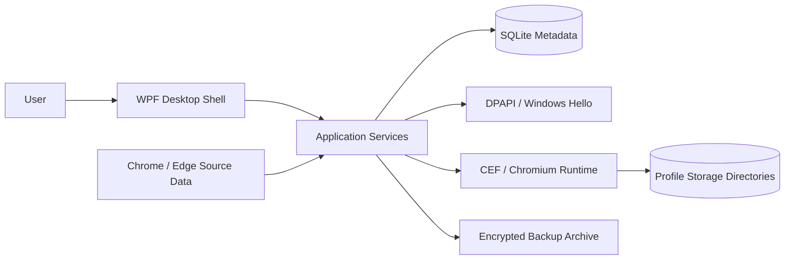

# Software Architecture — Switchly Next

**Status:** DRAFT — candidate stack, gated by M-001 proof-of-concept  
**Platform:** Windows desktop x64; Windows 11 primary, Windows 10 compatibility goal  
**Architecture style:** modular monolith desktop application + embedded browser runtime

## 1. Architectural drivers

Priority provider compatibility targets: Google Flow (https://flow.google), ChatGPT (https://chatgpt.com), Dola (https://dola.com), and SeaArt (https://seaart.ai). This is a test list, not a guarantee of provider acceptance. Respect each provider's authentication, age, and acceptable-use policies.


- `REQ-001` desktop shell dengan workspace, tab, dan multi-window.
- `REQ-003` isolasi storage antarprofil.
- `REQ-005` multi-profile concurrency dengan pengelolaan resource.
- `REQ-007` dukungan ekstensi bersifat opsional dan bukan driver MVP.
- `REQ-008` impor browser.
- `REQ-010` proteksi lokal.
- `REQ-011` encrypted backup lintas komputer.
- `REQ-012` basic use tanpa registrasi.
- `NFR-PERF-*` menghindari proses untuk profil idle dan mengukur penggunaan RAM.

## 2. Kandidat stack

| Layer | Teknologi kandidat | Alasan | Tradeoff / kondisi | ADR |
|---|---|---|---|---|
| Desktop UI | C# + WPF, MVVM | Mature Windows desktop UI; cocok untuk sidebar, multi-window, accessibility | Windows-only; binding ke native browser control | ADR-001 |
| Runtime | .NET 10 LTS | LTS modern dan tooling matang | Win10 Home/Pro tidak tercantum sebagai supported OS pada matrix .NET 10; perlu policy compatibility | ADR-002 |
| Embedded browser | CefSharp WPF 156.x / CEF 156.x candidate | Chromium embedded, WPF integration, per-profile request contexts | Chrome Runtime is the only mode in CEF 156+ (Alloy removed); extensions are optional and may have limited compatibility | ADR-003 |
| Local metadata | SQLite + EF Core 10.x | Local relational data and migrations | DB owns metadata only, not Chromium's internal data | ADR-004 |
| Local secrets | Windows DPAPI / Windows Hello integration | Local key protection tied to Windows user/device | Cross-device restore must use separate portable archive key | ADR-005 |
| Backup encryption | AES-256-GCM + password-derived key | Authenticated encryption; portable archive | Passphrase recovery unavailable; KDF parameters need testing | ADR-006 |
| Logging | Microsoft.Extensions.Logging + rolling local files | Structured diagnostic events | Redact URLs/credentials as needed; opt-in diagnostics policy TBD | ADR-007 |
| Installer | MSIX or signed installer candidate | Predictable Windows install/update | Select after install/update PoC and signing-cost decision | ADR-008 |

**Package note:** the engine spike (TASK-001) pins `CefSharp.Wpf.NETCore 156.0.300` (CEF 156.0.30 + chromium-156.0.8078.96). The release/CEF runtime version must be pinned together and rechecked before implementation. See [CefSharp package](https://www.nuget.org/packages/CefSharp.Wpf.NETCore/) and [CefSharp repository](https://github.com/cefsharp/CefSharp).

## 3. System context



The product is initially local-first. No cloud service is needed for the Free workflow. Pro entitlement and payment services are future integrations and are not part of the first vertical slice.

## 4. Module boundaries

Recommended solution layout:

```text
src/
  Switchly.App/
    App.xaml
    Views/
    ViewModels/
    Navigation/
    Composition/
  Switchly.Domain/
    Profiles/
    Groups/
    Bookmarks/
    History/
    Extensions/
    Import/
    Backup/
    Security/
  Switchly.Application/
    Profiles/
    Browser/
    Import/
    Backup/
    Security/
    ResourceManagement/
  Switchly.Infrastructure/
    Persistence/
    BrowserEngine/
    Import/
    Backup/
    Crypto/
    WindowsSecurity/
    Diagnostics/
  Switchly.BrowserHost/
    CefBootstrap/
    CefCallbacks/
    BrowserAdapters/
    OptionalExtensions/
tests/
  Switchly.Domain.Tests/
  Switchly.Application.Tests/
  Switchly.Infrastructure.Tests/
  Switchly.E2E.Tests/
```

### Ownership and dependency direction

- `Switchly.App`: WPF views, viewmodels, navigation and composition root only.
- `Switchly.Domain`: entities, value objects and policies; no WPF/CEF/SQLite dependency.
- `Switchly.Application`: use cases and interfaces/ports; coordinates workflows.
- `Switchly.Infrastructure`: SQLite, filesystem, DPAPI, encryption, import parsers, backup archive adapters.
- `Switchly.BrowserHost`: encapsulates CefSharp/CEF APIs; exposes narrow interfaces to application layer.
- Dependency direction: App → Application → Domain; Infrastructure and BrowserHost implement application ports. Domain must never depend on CEF, WPF, or persistence packages.

## 5. Browser profile isolation model

### 5.1 Profile as isolation boundary
- `CefSettings.RootCachePath` is `%LOCALAPPDATA%\SwitchlyNext\Profiles` (CEF's user-data dir).
- Each `BrowserProfile` owns a dedicated storage root at `%LOCALAPPDATA%\SwitchlyNext\Profiles\<profile-guid>` — a **direct child** of `RootCachePath` (Chrome Runtime rejects deeper paths and silently falls back to in-memory).
- Each active profile is created with a separate `CefRequestContext` and a unique persistent `CachePath` equal to that profile directory.
- Tabs and windows belonging to one profile share that profile request context.
- A different profile receives a different request context and path.
- Global CEF settings and global cache are for installation/runtime data only; never use the global context for user web sessions.
- `persist_session_cookies` behavior must be set and verified intentionally; session-cookie persistence is a user-visible privacy/session setting.
- Browser profile deletion removes its profile directory only after process/context handles are closed and user confirms.

CEF exposes per-request-context cache paths; a unique path is the mechanism used to maintain independent persistent storage. See [CEF RequestContextSettings](https://cef-builds.spotifycdn.com/docs/156.0/structcef__request__context__settings__t.html) and [CefRequestContext](https://cef-builds.spotifycdn.com/docs/156.0/classCefRequestContext.html).

### 5.2 Application lifecycle
- `Closed`: no live CEF browser for the profile.
- `Starting`: acquire profile lock, load context, open startup URL/session.
- `Active`: one or more tabs/windows are live.
- `Suspending`: persist tab state, flush DB and close browsers.
- `Suspended`: no renderer associated with the profile, profile data stays on disk.
- `Error`: close safely, retain diagnostics without secrets, allow retry.
- One app instance must prevent simultaneous write access to the same profile cache path. Use per-profile named mutex or lock file with process identity and stale-lock recovery.

### 5.3 Resource policy
- Never create a browser process for all saved profiles at startup.
- Lazy-open a profile when requested.
- Closing the final browser window for a profile suspends/closes that profile unless restore-on-start behavior asks otherwise.
- Tabs in background use normal Chromium throttling. Avoid injecting scripts to force suspend/disable site functionality.
- Collect process/memory metrics for diagnostics; do not kill renderers without explaining potential data loss.
- Active profile count is limited by resource availability, not an arbitrary product quota. Warn and offer close/suspend.

## 6. Main runtime flows

### Flow A — Open profile
1. UI calls `OpenProfile(profileId)`.
2. Application validates existence, archive state, and profile lock.
3. BrowserHost creates a request context using unique profile cache path.
4. Existing tab-session metadata is loaded; each URL is restored as a tab.
5. CEF navigation events are translated to application events.
6. Bookmark/history/download events persist through profile-scoped repositories.
7. Failure releases partial resources and surfaces actionable error.

### Flow B — Optional extension management
1. Extension manager requests package/source information.
2. Application validates source and extension manifest metadata.
3. BrowserHost invokes the CEF extension path supported by the selected runtime.
4. Permission details are shown before install.
5. Extension install status is recorded per profile.
6. If extension UI/API limitations block install/update/uninstall, keep the optional feature out of scope; do not build a fake success state.

### Flow C — Backup
1. Application blocks writes to selected profile or requests profile shutdown for a consistent snapshot.
2. Repositories checkpoint SQLite; browser profile directories are copied to staging.
3. Archive manifest and file hashes are created.
4. Backup encryption service derives an archive key from passphrase and encrypts payload with authenticated encryption.
5. Output written to temporary file, then atomically renamed.
6. Temporary plaintext staging is removed best-effort; diagnostics redact paths with user data.

## 7. Persistence and data contracts

- SQLite owns application metadata: profiles, groups, settings, tab restore metadata, bookmarks, application history projection, optional extension registry, backup jobs, import jobs.
- CEF profile directory owns browser runtime storage: cookies, local storage, IndexedDB, cache, service workers and compatible extension storage.
- Credential vault stores imported CSV credentials in encrypted per-profile records. Do not store secrets as plaintext SQLite values.
- See [schema.md](./schema.md) for authoritative entities, constraints and migration strategy.

## 8. Security boundaries

Trust zones:
1. User-controlled website content — untrusted.
2. Browser engine profile context — untrusted remote content, isolated per profile.
3. Application UI/process — trusted app code but receives untrusted import/browser inputs.
4. Local persistent metadata — protected by Windows user profile and file ACL.
5. Credential vault — encrypted at rest; decrypt only when user authorizes needed operation.
6. Backup output — encrypted using portable passphrase-derived key.

Controls:
- Validate URLs, imported paths, archive paths, extension packages and CSV data.
- Prevent path traversal during backup restore.
- Redact passwords, tokens, full URL query strings and cookie values from logs.
- Use Windows DPAPI (`CurrentUser`) for local wrapping of vault master key; use independent password-based key derivation for portable backup.
- Windows Hello is an optional unlock experience, not a replacement for authenticated encryption.
- Do not import source browser cookies or sessions.
- Do not send browsing history/profile metadata to a remote service by default.
- No production telemetry until privacy decision is explicit.

## 9. Import architecture

- Browser discovery identifies Chrome/Edge installation and candidate user profiles.
- Source adapters run read-only and never modify original browser data.
- If source database files are locked, ask user to close source browser; do not kill it.
- Bookmark importer accepts browser-native JSON or Netscape HTML export.
- History importer reads supported Chromium SQLite schema with version-tolerant queries.
- Tab importer reconstructs URLs only from supported source session format; if parsing fails, return unsupported rather than silently skip.
- Extension importer creates a compatibility report and attempts reinstall only through approved source/runtime support.
- Password importer accepts user-selected CSV, parses supported Chrome/Edge columns, and sends values directly to vault writer without logs/temp plaintext persistence.
- No cookies/session importer.

## 10. Installer, update, and release

- Initial deployment: signed x64 Windows installer, exact format selected in ADR-008 after PoC.
- Bundle the required CEF/VC++ runtime redistributables per license and publisher instructions.
- Keep CEF security updates on a recurring schedule and document the Chromium version bundled in each release.
- Update mechanism must verify signatures and reject downgrade/tampered packages.
- Do not auto-update the browser runtime independently of the app's tested compatibility set.
- Windows 10 Home/Pro compatibility is a release-policy decision, not inferred from successful local compilation.

## 11. Known risks and evolution triggers

| Risk | Consequence | Mitigation / trigger |
|---|---|---|
| Embedded browser may be rejected by individual websites | Provider policies can restrict embedded user agents or sign-in flows | Validate the four priority websites; do not bypass provider policy; document unsupported flows. |
| Renderer RAM scales with active sites | Heavy use can exhaust memory | Lazy profiles, profiling, measured resource warning, no universal RAM claim. |
| CEF build/runtime updates | Security and compatibility maintenance | Pin CEF/CefSharp versions and test before updating. |
| Win10 Home/Pro is out of support | Security/support promise mismatch | Define best-effort policy or raise minimum OS before public release. |
| Password CSV is plaintext | User credential exposure | Explicit warning, memory-first parse, encrypted vault, no logs. |
| Chrome/Edge source schema changes | Import can break | Version-aware adapters + fixtures + partial failure report. |

## 12. Next implementation decision

`M-001` is a browser-engine proof-of-concept, not full UI development. It must test:
- Per-profile isolated `CefRequestContext` directories.
- Cookie/localStorage separation and persistence across restart.
- CEF (Chrome Runtime) startup and WPF window hosting.
- Optional extension loading only if supported by the selected CEF distribution; no Chrome Web Store parity commitment.
- Extension UI/permissions/update/uninstall are deferred beyond MVP.
- Download handling and popup/new-window behavior.
- RAM/CPU baseline for one idle profile, one active profile, and multiple concurrent profiles.
- Windows 11 and the intended Windows 10 editions.

If M-001 cannot meet profile isolation, basic browser stability, or the required website workflows, stop and report the evidence before implementing the full product. Extension limitations alone do not block the MVP.
