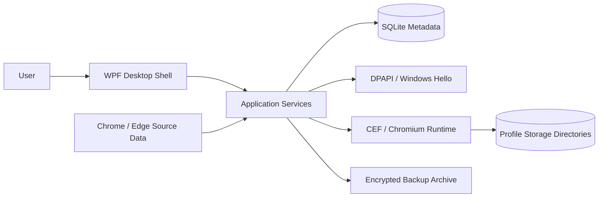

# Software Architecture — Switchly Next

**Status:** ACTIVE — M-001..M-004, M-006..M-008, D6, and D7 verified on Windows 11; refined per PO decisions D1–D7 (2026-11-25)  
**Platform:** Windows desktop x64; Windows 11 primary, Windows 10 compatibility goal  
**Architecture style:** modular monolith desktop application + embedded browser runtime

## 1. Architectural drivers

Priority provider compatibility targets: Google Flow (https://flow.google), ChatGPT (https://chatgpt.com), Dola (https://dola.com), and SeaArt (https://seaart.ai). This is a test list, not a guarantee of provider acceptance. Respect each provider's authentication, age, and acceptable-use policies.


- `REQ-001` desktop shell dengan workspace, tab, dan multi-window.
- `REQ-003` isolasi storage antarprofil.
- `REQ-005` multi-profile concurrency dengan pengelolaan resource.
- `REQ-007` dukungan ekstensi bersifat opsional dan bukan driver MVP.
- `REQ-008` impor browser.
- `REQ-010` proteksi lokal.
- `REQ-011` encrypted backup lintas komputer.
- `REQ-012` basic use tanpa registrasi.
- `NFR-PERF-*` menghindari proses untuk profil idle dan mengukur penggunaan RAM.

## 2. Technology stack

| Layer | Technology | Rationale | Tradeoff / condition | ADR |
|---|---|---|---|---|
| Desktop UI | C# + WPF, MVVM | Mature Windows desktop UI; suited for sidebar, multi-window, accessibility | Windows-only; browser hosting isolated behind `Switchly.BrowserHost` | ADR-001 |
| Runtime | .NET 10 LTS | Modern LTS and mature tooling; aligned `10.x` packages via `Directory.Packages.props` | Win10 Home/Pro not listed as supported OS on .NET 10 matrix; best-effort pending policy | ADR-002 |
| Embedded browser | `CefSharp.Wpf.NETCore 156.0.300` / CEF `156.0.30` (Chromium `156.0.8078.96`) | Chromium embedded, WPF integration, per-profile request contexts | Chrome Runtime is the only mode since CEF 128 (Alloy removed); extensions optional/deferred; must be isolated in `Switchly.BrowserHost` | ADR-003, ADR-011 |
| Local metadata | Plain SQLite + EF Core 10.x | Local relational metadata and versioned migrations | Non-secret metadata + AEAD-encrypted `VaultCredential` blobs (D6); no plaintext passwords/cookies/tokens in SQLite; CEF owns internal browser storage | ADR-004 |
| Local security | Windows DPAPI (`CurrentUser`) + optional master password / Windows Hello + AES-256-GCM Vault | Local protection tied to Windows user/device | Encrypted password vault (`ENT-009`) & CSV import implemented per D6; portable backup uses separate passphrase key | ADR-005 |
| Backup encryption | Manual chunked streaming AES-256-GCM + passphrase KDF | Authenticated streaming encryption; portable across Windows PCs | Device-bound Chromium cookies excluded on cross-device restore (D3); scheduled backup deferred post-MVP (D2) | ADR-006 |
| Logging | `Microsoft.Extensions.Logging` + rolling local files | Structured diagnostic events | Redact URLs/credentials/paths; no cloud telemetry without opt-in | ADR-007 |
| Installer | MSIX or signed setup installer (open) | Predictable Windows install/update | Select after install/update PoC and signing-cost decision | ADR-008 |

**Package note:** M-001 `TASK-001` pinned `CefSharp.Wpf.NETCore 156.0.300` (CEF `156.0.30` + `chromium-156.0.8078.96`). All `Microsoft.Extensions.*` and EF Core packages must stay aligned on `10.x` LTS via `Directory.Packages.props` (D5). See [CefSharp package](https://www.nuget.org/packages/CefSharp.Wpf.NETCore/) and [CefSharp repository](https://github.com/cefsharp/CefSharp).

## 3. System context



The product is initially local-first. No cloud service is needed for the Free workflow. Pro entitlement and payment services are future integrations and are not part of the first vertical slice.

## 4. Module boundaries

Recommended solution layout:

```text
src/
  Switchly.App/
    App.xaml
    Views/
    ViewModels/
    Navigation/
    Composition/
  Switchly.Domain/
    Profiles/
    Groups/
    Tabs/
    Bookmarks/
    History/
    Downloads/
    Import/
    Backup/
    Security/
  Switchly.Application/
    Profiles/
    Browser/
    Import/
    Backup/
    Security/
    ResourceManagement/
  Switchly.Infrastructure/
    Persistence/
    Import/
    Backup/
    Crypto/
    WindowsSecurity/
    Diagnostics/
  Switchly.BrowserHost/
    CefBootstrap/
    CefCallbacks/
    BrowserAdapters/
    OptionalExtensions/
tests/
  Switchly.Domain.Tests/
  Switchly.Application.Tests/
  Switchly.Infrastructure.Tests/
  Switchly.E2E.Tests/
```

### Ownership and dependency direction

- `Switchly.App`: WPF views, viewmodels, navigation and composition root only. Must **not** reference `CefSharp.*` NuGet packages directly (D5); hosts browser surfaces strictly through `Switchly.BrowserHost`.
- `Switchly.Domain`: entities, value objects and policies; no WPF/CEF/SQLite dependency.
- `Switchly.Application`: use cases and interfaces/ports; coordinates workflows.
- `Switchly.Infrastructure`: SQLite, filesystem, DPAPI, encryption, import parsers, backup archive adapters. Does not own browser-engine adapters.
- `Switchly.BrowserHost`: sole owner of `CefSharp.Wpf.NETCore`/CEF APIs and CEF lifecycle; exposes narrow interfaces to application/UI layers.
- Dependency direction: App → Application → Domain; Infrastructure and BrowserHost implement application ports. Domain must never depend on CEF, WPF, or persistence packages.

## 5. Browser profile isolation model

### 5.1 Profile as isolation boundary
- `CefSettings.RootCachePath` is `%LOCALAPPDATA%\SwitchlyNext\Profiles` (CEF's user-data dir).
- Each `BrowserProfile` owns a dedicated storage root at `%LOCALAPPDATA%\SwitchlyNext\Profiles\<profile-guid>` — a **direct child** of `RootCachePath` (Chrome Runtime rejects deeper paths and silently falls back to in-memory).
- Each active profile is created with a separate `CefRequestContext` and a unique persistent `CachePath` equal to that profile directory.
- Tabs and windows belonging to one profile share that profile request context.
- A different profile receives a different request context and path.
- Global CEF settings and global state (`Default`, `Local State`, shader/crashpad caches) reside inside `RootCachePath` (`ADR-011`) for installation/runtime data only; never use the global context for user web sessions, and never include CEF global state in profile backups.
- `persist_session_cookies` defaults to `true` (D4) and is exposed as a user-visible per-profile privacy/session setting.
- Browser profile deletion removes its profile directory only after process/context handles are closed and user confirms (with a startup deferred-delete tombstone queue if Windows retains a Chromium handle until restart).

CEF exposes per-request-context cache paths; a unique direct-child path is the mechanism used to maintain independent persistent storage. See [CEF RequestContextSettings](https://cef-builds.spotifycdn.com/docs/156.0/structcef__request__context__settings__t.html) and [CefRequestContext](https://cef-builds.spotifycdn.com/docs/156.0/classCefRequestContext.html).

### 5.2 Application lifecycle
- `Closed`: no live CEF browser for the profile.
- `Starting`: acquire profile lock, load context, open startup URL/session.
- `Active`: one or more tabs/windows are live.
- `Suspending`: persist tab state, flush DB and close browsers.
- `Suspended`: no renderer associated with the profile, profile data stays on disk.
- `Error`: close safely, retain diagnostics without secrets, allow retry.
- Because CEF Chrome Runtime enforces a process-wide Chromium `ProcessSingleton` lock on `RootCachePath` (`ADR-011`), Switchly Next enforces an **app-level single-instance guard** (Windows named mutex + IPC focus/argument handoff) *before* `Cef.Initialize()`, combined with in-process per-profile state locks.

### 5.3 Resource policy
- Never create a browser process for all saved profiles at startup.
- Lazy-open a profile when requested.
- Closing the final browser window for a profile suspends/closes that profile unless restore-on-start behavior asks otherwise.
- Tabs in background use normal Chromium throttling. Avoid injecting scripts to force suspend/disable site functionality.
- Collect process/memory metrics for diagnostics; do not kill renderers without explaining potential data loss.
- Active profile count is limited by resource availability, not an arbitrary product quota. Warn and offer close/suspend.

## 6. Main runtime flows

### Flow A — Open profile
1. UI calls `OpenProfile(profileId)`.
2. Application validates existence, archive state, and profile lock.
3. BrowserHost creates a request context using unique profile cache path.
4. Existing tab-session metadata is loaded; each URL is restored as a tab.
5. CEF navigation events are translated to application events.
6. Bookmark/history/download events persist through profile-scoped repositories.
7. Failure releases partial resources and surfaces actionable error.

### Flow B — Optional extension management
1. Extension manager requests package/source information.
2. Application validates source and extension manifest metadata.
3. BrowserHost invokes the CEF extension path supported by the selected runtime.
4. Permission details are shown before install.
5. Extension install status is recorded per profile.
6. If extension UI/API limitations block install/update/uninstall, keep the optional feature out of scope; do not build a fake success state.

### Flow C — Manual Backup and Staged Restore (MVP)
1. User initiates a manual backup (scheduled unattended backup is deferred post-MVP per D2). Application ensures target profiles are closed/flushed for a consistent snapshot.
2. Repositories checkpoint SQLite (`switchly-next.db`); only registered `<profile-guid>` directories are read — **never** CEF global state (`Default`, `Local State`) and excluding regenerable caches (`Cache`, `Code Cache`, `GPUCache`, `GrShaderCache`, `DawnCache`, `Crashpad`) per `ADR-011` and D3.
3. Archive manifest and file hashes are created.
4. Backup encryption service derives an archive key from user passphrase and stream-encrypts payload using a **chunked AES-256-GCM** format (per-chunk nonces, final-chunk flag, header digest in AAD) without duplicating multi-GB plaintext staging on disk.
5. Output written to temporary file, then atomically renamed.
6. On restore, archive integrity and passphrase are verified into a staging directory; device-bound Chromium `Cookies` are excluded on cross-device restore (D3); promotion executes via a **restart-to-restore staged directory swap** before `Cef.Initialize()` and EF Core open file handles.

## 7. Persistence and data contracts

- SQLite (`switchly-next.db`, plain SQLite protected by Windows user ACLs per `ADR-004` / D4) owns non-secret application metadata: profiles, groups, settings, tab restore metadata, bookmarks, application history projection, download records, backup jobs, import jobs, and (if later approved) optional extension registry.
- CEF profile directory owns browser runtime storage: cookies, local storage, IndexedDB, cache, service workers and compatible extension storage.
- No website passwords, cookies, or OAuth tokens are stored in `switchly-next.db` in MVP (custom CSV password vault `ENT-009` is deferred post-MVP per D1).
- See [schema.md](./schema.md) for authoritative entities, constraints and migration strategy.

## 8. Security boundaries

Trust zones:
1. User-controlled website content — untrusted.
2. Browser engine profile context — untrusted remote content, isolated per profile.
3. Application UI/process — trusted app code but receives untrusted import/browser inputs.
4. Local persistent metadata — protected by Windows user profile and file ACL.
5. Credential vault — encrypted at rest; decrypt only when user authorizes needed operation.
6. Backup output — encrypted using portable passphrase-derived key.

Controls:
- Validate URLs, imported paths, archive paths, extension packages and CSV data.
- Prevent path traversal during backup restore.
- Redact passwords, tokens, full URL query strings and cookie values from logs.
- Use Windows DPAPI (`CurrentUser`) for local wrapping of vault master key; use independent password-based key derivation for portable backup.
- Windows Hello is an optional unlock experience, not a replacement for authenticated encryption.
- Do not import source browser cookies or sessions.
- Do not send browsing history/profile metadata to a remote service by default.
- No production telemetry until privacy decision is explicit.

## 9. Import architecture

- Browser discovery identifies Chrome/Edge installation and candidate user profiles.
- Source adapters run read-only and never modify original browser data.
- If source database files are locked, ask user to close source browser; do not kill it.
- Bookmark importer accepts browser-native JSON or Netscape HTML export.
- History importer reads supported Chromium SQLite schema with version-tolerant queries.
- Tab importer reconstructs URLs only from supported source session format; if parsing fails, return unsupported rather than silently skip.
- Extension importer creates a compatibility report (informational only in MVP; reinstall deferred).
- Password CSV importer and custom credential vault are deferred to post-MVP (D1).
- No cookies/session importer (`ADR-010`).

## 10. Installer, update, and release

- Initial deployment: signed x64 Windows installer, exact format selected in ADR-008 after PoC.
- Bundle the required CEF/VC++ runtime redistributables per license and publisher instructions.
- Keep CEF security updates on a recurring schedule and document the Chromium version bundled in each release.
- Update mechanism must verify signatures and reject downgrade/tampered packages.
- Do not auto-update the browser runtime independently of the app's tested compatibility set.
- Windows 10 Home/Pro compatibility is a release-policy decision, not inferred from successful local compilation.

## 11. Known risks and evolution triggers

| Risk | Consequence | Mitigation / trigger |
|---|---|---|
| Embedded browser may be rejected by individual websites | Provider policies can restrict embedded user agents or sign-in flows | Validate the four priority websites; do not bypass provider policy; document unsupported flows. |
| Renderer RAM scales with active sites | Heavy use can exhaust memory | Lazy profiles, profiling, measured resource warning, no universal RAM claim. |
| CEF build/runtime updates | Security and compatibility maintenance | Pin CEF/CefSharp versions and test before updating. |
| Win10 Home/Pro is out of support | Security/support promise mismatch | Define best-effort policy or raise minimum OS before public release. |
| Password CSV is plaintext | User credential exposure | Explicit warning, memory-first parse, encrypted vault, no logs. |
| Chrome/Edge source schema changes | Import can break | Version-aware adapters + fixtures + partial failure report. |

## 12. Current implementation gate (M-001 complete on Win11 → M-002 cleanup)

`M-001` (`artifacts/engine-spike/`) and the M-002 manual sign-in gate validated on Windows 11:
- Per-profile isolated `CefRequestContext` direct-child directories (`ADR-011`, `TEST-003`/`004`/`017`).
- Priority provider public pages and manual sign-in for Google Flow, ChatGPT, Dola, and SeaArt (`task-003-results.md`).
- Downloads, popups/new windows, renderer crash recovery (`TEST-021`, `task-004-results.md`), and low-RAM resource baseline (`TEST-016`, `task-005-results.md`).

Remaining gates before starting `M-003`:
- Enforce strict `Switchly.BrowserHost` isolation (move `CefSharp.Wpf.NETCore` out of `Switchly.App` behind `IBrowser*` ports) and align NuGet `10.x` LTS packages via `Directory.Packages.props` (D5).
- Verify non-elevated (`asInvoker`) WPF hosting stability and complete `M-002` `TASK-010` (CI + build/test verification).
- Keep Windows 10 compatibility checks (`REQ-014`) and installer PoC (`ADR-008`) tracked as explicit release gates.
