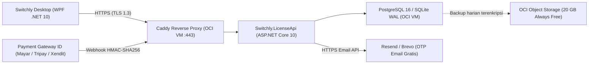

# Switchly — Arsitektur Billing, Lisensi & Trial 7 Hari (Oracle Cloud Always Free)

**Status:** Disetujui Product Owner (`M-009` / `REQ-013` / `D16`) — siap implementasi bertahap.  
**Target Pasar:** Indonesia-First (IDR via **Midtrans Snap**: QRIS, Virtual Account, GoPay/ShopeePay, Kartu Kredit) · Hybrid Pricing (Langganan + Perpetual).  
**Infrastruktur Server:** Oracle Cloud Infrastructure (OCI) Always Free **Ampere A1 (ARM64)** + **PostgreSQL 16** + **Caddy** (Docker Compose).

---

## 1. Ringkasan Model Bisnis (`D16`)

| Tier | Syarat Akun | Batas Profil | Fitur | Harga Referensi (IDR) |
|---|---|---|---|---|
| **Free** | **Tanpa login** (`REQ-012`) | Maks. **5 profil aktif** | Isolasi penuh, DPAPI / Windows Hello, backup manual | **Rp 0** selamanya |
| **Trial Pro (7 Hari)** | **Buat akun** (Email + OTP) | **Unlimited** | Semua fitur Pro penuh selama 7 hari (tanpa kartu kredit) | **Rp 0** (1× per akun & perangkat) |
| **Pro Bulanan** | Akun Switchly | **Unlimited** | Semua fitur Pro, maks. **2 PC Windows** | **Rp 39.000 / bulan** |
| **Pro Tahunan** | Akun Switchly | **Unlimited** | Semua fitur Pro, maks. **2 PC Windows** | **Rp 249.000 / tahun** |
| **Pro Perpetual** | Akun Switchly | **Unlimited** | Pakai selamanya di versi yang dibeli + **update 1 tahun**, maks. **2 PC** | **Rp 399.000** *(Early-Bird Rp 249.000)* |

> **Prinsip Non-Destruktif (Graceful Downgrade):** Jika Trial 7 hari atau langganan Pro berakhir, **profil, cookies, bookmark, dan Password Vault TIDAK pernah dihapus**. User tetap bisa menggunakan hingga 5 profil; profil selebihnya ditandai badge `Pro` (terkunci untuk dibuka baru) sampai user upgrade atau mengarsipkan/menghapus profil lain hingga ≤ 5.

---

## 2. Arsitektur Sistem di Oracle Cloud Always Free

Karena Switchly Desktop ditulis dengan **C# / .NET 10**, backend lisensi paling efisien juga dibangun dengan **ASP.NET Core 10 Minimal API** (satu bahasa, model DTO bisa berbagi kontrak, konsumsi RAM sangat kecil ~50 MB).



### Stack OCI Always Free Ampere A1 (Final — Biaya Rp 0/bulan)
1. **VM:** Ubuntu 24.04 LTS ARM64 (`VM.Standard.A1.Flex`, 2–4 OCPU / 12–24 GB RAM).
2. **Orkestrasi:** **Docker Compose** (`linux/arm64` native images: `caddy:2-alpine`, `postgres:16-alpine`, `switchly-license-api` berbasis `mcr.microsoft.com/dotnet/aspnet:10.0-alpine`).
3. **Reverse Proxy:** **Caddy** (otomatis Let's Encrypt HTTPS untuk `api.switchly.id`, tanpa konfigurasi SSL manual).
4. **Backend API:** `server/Switchly.LicenseApi` (ASP.NET Core 10 Minimal API + EF Core Npgsql).
5. **Database:** **PostgreSQL 16** (volume persisten + `pg_dump` harian terenkripsi ke OCI Object Storage 20 GB Always Free).
6. **Email OTP:** **Resend** (3.000 email/bulan gratis) atau **Brevo** (300 email/hari gratis) via **HTTPS API** *(OCI memblokir outbound SMTP port 25 secara default)*.
7. **Payment Gateway Indonesia:** **Midtrans Snap** (Sandbox & Production) — QRIS, GoPay, ShopeePay, BCA/BRI/BNI/Mandiri/Permata VA, Kartu Kredit.
   - Verifikasi webhook: `SHA512(order_id + status_code + gross_amount + MidtransServerKey)` dibandingkan secara *constant-time* (`CryptographicOperations.FixedTimeEquals`) terhadap `signature_key`.
   - Status *paid*: `transaction_status == "settlement"` atau (`transaction_status == "capture"` && `fraud_status == "accept"`).
   - Idempotensi: `external_order_id` (`UNIQUE`) pada tabel `licenses` mencegah aktivasi ganda jika Midtrans mengirim ulang webhook.

---

## 3. Skema Database (`Switchly.LicenseApi`)

### `accounts`
| Kolom | Tipe | Keterangan |
|---|---|---|
| `id` | `UUID` (PK) | ID unik akun Switchly |
| `email_normalized` | `TEXT` (UNIQUE) | Email huruf kecil + trim (untuk deteksi duplikat) |
| `created_at_utc` | `TIMESTAMP` | Waktu pendaftaran |
| `trial_claimed_at_utc` | `TIMESTAMP` (NULL) | Diisi sekali saat Trial 7 hari diklaim |
| `trial_expires_at_utc` | `TIMESTAMP` (NULL) | `trial_claimed_at_utc + 7 days` |
| `status` | `TEXT` | `active` \| `suspended` |

### `otp_challenges`
| Kolom | Tipe | Keterangan |
|---|---|---|
| `id` | `UUID` (PK) | ID challenge |
| `email_normalized` | `TEXT` (INDEX) | Target email |
| `code_hash` | `TEXT` | SHA-256 dari OTP 6 digit + salt (tidak disimpan plaintext) |
| `expires_at_utc` | `TIMESTAMP` | Berlaku 10 menit |
| `attempts` | `INT` | Maks. 5 percobaan per challenge |
| `consumed_at_utc` | `TIMESTAMP` (NULL) | Ditandai terpakai setelah verifikasi |

### `trial_device_claims` *(Anti-Abuse 7-Day Trial)*
| Kolom | Tipe | Keterangan |
|---|---|---|
| `device_hash` | `TEXT` (PK) | `SHA256(WindowsMachineGuid + AppSalt)` — one-way hash, bukan data pribadi |
| `account_id` | `UUID` (FK) | Akun pertama yang mengklaim trial di PC ini |
| `claimed_at_utc` | `TIMESTAMP` | Waktu klaim |

### `licenses`
| Kolom | Tipe | Keterangan |
|---|---|---|
| `id` | `UUID` (PK) | ID lisensi |
| `account_id` | `UUID` (FK) | Pemilik lisensi |
| `plan_code` | `TEXT` | `pro_monthly` \| `pro_annual` \| `pro_perpetual` |
| `status` | `TEXT` | `active` \| `expired` \| `revoked` |
| `starts_at_utc` | `TIMESTAMP` | Mulai aktif |
| `expires_at_utc` | `TIMESTAMP` (NULL) | NULL untuk `pro_perpetual` |
| `updates_until_utc` | `TIMESTAMP` (NULL) | Batas update gratis 1 tahun untuk `pro_perpetual` |
| `max_devices` | `INT` | Default `2` |
| `payment_provider` | `TEXT` | `mayar` \| `tripay` \| `xendit` \| `manual` |
| `external_order_id` | `TEXT` (UNIQUE) | ID transaksi gateway (idempoten terhadap webhook duplikat) |

### `device_activations`
| Kolom | Tipe | Keterangan |
|---|---|---|
| `id` | `UUID` (PK) | ID aktivasi |
| `account_id` | `UUID` (FK) | Pemilik akun |
| `device_hash` | `TEXT` | Hash perangkat Windows |
| `device_label` | `TEXT` | Nama tampilan opsional (misal `DESKTOP-WORK`) |
| `last_seen_utc` | `TIMESTAMP` | Terakhir refresh token |
| `revoked_at_utc` | `TIMESTAMP` (NULL) | Jika user me-nonaktifkan PC lama dari Settings |

---

## 4. Kontrak REST API (`https://api.switchly.id/v1`)

1. **`POST /v1/auth/otp/request`**
   - Body: `{ "email": "user@example.com" }`
   - Rate limit: maks. 3 request / 15 menit per IP & email. Menolak domain *disposable email* populer.
2. **`POST /v1/auth/otp/verify`**
   - Body: `{ "email": "...", "code": "123456", "device_hash": "...", "device_label": "..." }`
   - Output: `{ "session_token": "...", "entitlement_token": "<Ed25519-signed>", "trial_eligible": true|false }`
3. **`POST /v1/trial/start`** *(Authenticated)*
   - Validasi: `account.trial_claimed_at_utc == null` **DAN** `trial_device_claims` belum memiliki `device_hash` ini.
   - Output: `entitlement_token` baru dengan `tier = "trial_pro"`, `expires_at_utc = now + 7d`.
4. **`POST /v1/entitlement/refresh`** *(Authenticated)*
   - Dipanggil otomatis saat startup Switchly (background, non-blocking) atau saat user klik *"Perbarui Status Lisensi"* setelah bayar QRIS.
   - Mengembalikan `entitlement_token` terbaru yang ditandatangani **Ed25519**.
5. **`GET /v1/devices`** & **`DELETE /v1/devices/{id}`** *(Authenticated)*
   - Memungkinkan user melihat dan mencabut perangkat lama (maks. 2 PC) langsung dari `Pengaturan → Akun & Lisensi`.
6. **`POST /v1/billing/checkout`** *(Authenticated)*
   - Body: `{ "plan_code": "pro_annual" | "pro_monthly" | "pro_perpetual" }`
   - Membuat invoice QRIS/VA di payment gateway dan mengembalikan `checkout_url` (dibuka di browser default Windows atau tab checkout).
7. **`POST /v1/webhooks/payment/{provider}`**
   - Verifikasi **HMAC-SHA256 signature** dari gateway, cek idempotensi `external_order_id`, lalu buat/perpanjang baris `licenses`.

---

## 5. Format Signed License Token (Offline-First Ed25519)

Agar Switchly tetap 100% bisa dipakai saat offline (sesuai filosofi *local-first*):
- Server menandatangani JSON payload menggunakan **Ed25519 Private Key** (`0600` di OCI VM, tidak pernah masuk Git).
- Switchly Desktop hanya menyimpan **Ed25519 Public Key** (read-only) untuk memverifikasi tanda tangan secara lokal.
- Token disimpan di `%LocalAppData%\SwitchlyNext\Data\license.dpapi` terenkripsi **Windows DPAPI (`CurrentUser`)**.

```json
{
  "v": 1,
  "sub": "acct_8f2a...",
  "tier": "pro_perpetual",
  "max_profiles": null,
  "device_hash": "sha256:...",
  "issued_at": "2026-11-26T05:00:00Z",
  "expires_at": null,
  "updates_until": "2027-11-26T05:00:00Z",
  "refresh_after": "2026-12-03T05:00:00Z",
  "offline_grace_until": "2026-12-10T05:00:00Z"
}
```

### Aturan Verifikasi Lokal di Switchly Desktop
- **Free (tanpa file token):** `ActiveTier = Free`, `MaxProfiles = 5`, `IsOfflineReady = true` (0 network call).
- **Trial Pro:** Valid jika tanda tangan Ed25519 cocok, `device_hash` cocok, dan `DateTimeOffset.UtcNow <= expires_at` (ditambah deteksi *clock rollback* sederhana lewat timestamp `last_seen_utc` lokal terenkripsi DPAPI).
- **Pro Bulanan / Tahunan:** Valid hingga `expires_at`; jika offline, tetap aktif sampai `offline_grace_until` (**14 hari** sejak refresh terakhir).
- **Pro Perpetual:** Valid selamanya untuk versi aplikasi yang dirilis `<= updates_until`; tidak butuh internet setelah aktivasi awal.

---

## 6. Pemetaan ke Kode Switchly yang Sudah Ada

Kontrak di [EntitlementModels.cs](file:///c:/Users/FLYONZ/Documents/PROJEK/Switchly_Next_Antigravity_Starter/src/Switchly.Domain/Entitlements/EntitlementModels.cs) dan [IFeatureEntitlementService.cs](file:///c:/Users/FLYONZ/Documents/PROJEK/Switchly_Next_Antigravity_Starter/src/Switchly.Application/Entitlements/IFeatureEntitlementService.cs) sudah siap diperluas secara minimal:

1. **`SubscriptionTier`:** Tambah `Free`, `TrialPro`, `ProSubscription`, `ProPerpetual` (tetap mempertahankan `FreeBeta` untuk build Beta).
2. **`IFeatureEntitlementService`:** Tambah `FeatureEntitlementDecision CanOpenProfile(Guid profileId, IReadOnlyList<Guid> orderedActiveProfileIds)` untuk mendukung *Graceful Downgrade* (profil 1–5 tetap bisa dibuka saat Free).
3. **`SignedTokenEntitlementService` (di `Switchly.Infrastructure`):** Menggantikan `FreeBetaEntitlementService` khusus pada build GA (dikontrol lewat konfigurasi rilis), membaca & memverifikasi `license.dpapi`.
4. **UI Minimal (di `SettingsView` + Modal Upgrade):**
   - Seksi **"Akun & Lisensi"** di `SettingsView`: status paket (Free 5 / Trial sisa X hari / Pro), tombol *"Coba Pro 7 Hari Gratis"*, *"Upgrade ke Pro (QRIS/VA)"*, *"Perbarui Lisensi"*, dan daftar perangkat aktif.
   - Modal halus saat user klik **"+ Profil Baru"** ketika profil aktif sudah mencapai **5** pada mode Free.

---

## 7. Checklist Keamanan & Operasional Oracle Cloud Always Free

- **Firewall OCI + `ufw`:** Hanya buka port `443` (HTTPS), `80` (ACME redirect), dan `22` (SSH key-only, nonaktifkan password SSH).
- **Anti-Idle Reclamation OCI:** OCI kadang menandai VM Ampere yang CPU-nya 0% terus-menerus sebagai idle; jadwalkan backup DB harian + log rotation, dan simpan backup terenkripsi ke **OCI Object Storage (20 GB Always Free)** agar data lisensi tidak pernah hilang meski VM perlu dibuat ulang.
- **Privasi (`docs/PRIVACY.md`):** Pembaruan dokumen privasi wajib menjelaskan bahwa untuk pengguna **Free (tanpa login)** tidak ada data yang dikirim ke server; untuk pengguna **Trial/Pro**, hanya `email` dan `device_hash` (SHA-256 satu arah) yang disimpan di server lisensi. Tidak ada data profil, URL, cookies, atau vault yang pernah dikirim ke server.

---

## 8. Urutan Implementasi Bertahap (`M-009` GA)

1. **Tahap A — Backend (`Switchly.LicenseApi`):** Scaffold ASP.NET Core 10 Minimal API + SQLite/Postgres + OTP Email + Ed25519 signer + Webhook adapter (Mayar/Tripay) + `Caddyfile` + `systemd` script untuk OCI.
2. **Tahap B — Domain & Client Entitlement:** Implementasi `SignedTokenEntitlementService`, `DpapiLicenseStore`, unit test verifikasi Ed25519 / graceful downgrade / offline grace / clock rollback.
3. **Tahap C — UI Trial & Upgrade:** Seksi `Akun & Lisensi` di `SettingsView`, modal OTP + Klaim Trial 7 Hari, dan banner sisa hari Trial.
4. **Tahap D — Uji End-to-End & Privacy Update:** Uji alur Free → profil ke-6 → OTP → Trial 7 hari → Checkout QRIS sandbox → Webhook → Pro aktif → Offline test.
