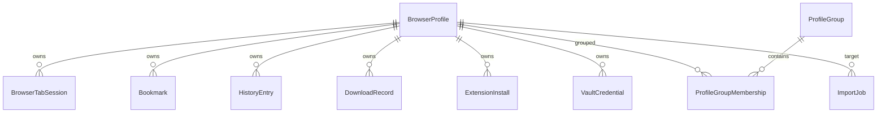

# Data & Interface Schema — Switchly Next

**Status:** ACTIVE 0.2 — updated per PO decisions D1–D5 (2026-11-24)  
**Source of truth:** This document owns local data contracts. Browser engine internal databases remain owned by CEF/Chromium.

## 1. Persistence overview

- Database: plain SQLite (`ADR-004` / D4), one local application database for non-secret metadata only (no website passwords, cookies, or OAuth tokens in MVP).
- Metadata path: `%LOCALAPPDATA%\SwitchlyNext\Data\switchly-next.db`.
- Browser data: `%LOCALAPPDATA%\SwitchlyNext\Profiles\<profile-guid>\` (one directory per profile). `RootCachePath` is `%LOCALAPPDATA%\SwitchlyNext\Profiles`, so each profile directory is a **direct child** of it (required by CEF Chrome Runtime, `ADR-011`).
- Backup archives: user-selected folder; stream-encrypted with chunked AES-256-GCM before final write (`ADR-006`).
- No cloud synchronization in MVP.
- Do not query/modify CEF's internal SQLite files directly except through documented read-only import/diagnostic adapters when absolutely needed.

## 2. Entity catalog

| ID | Entity | Key | Purpose | Requirement |
|---|---|---|---|---|
| ENT-001 | BrowserProfile | `ProfileId` GUID | Profile identity and lifecycle metadata | REQ-002, REQ-003, REQ-015 |
| ENT-002 | ProfileGroup | `GroupId` GUID | Manual and system-derived group metadata | REQ-004 |
| ENT-003 | ProfileGroupMembership | `(ProfileId, GroupId)` | Many-to-many membership | REQ-004 |
| ENT-004 | BrowserTabSession | `TabId` GUID | Restorable tab/window metadata | REQ-005, REQ-006 |
| ENT-005 | Bookmark | `BookmarkId` GUID | Application-managed per-profile bookmarks | REQ-006 |
| ENT-006 | HistoryEntry | `HistoryId` GUID | Profile-scoped history projection | REQ-006 |
| ENT-007 | DownloadRecord | `DownloadId` GUID | Download status and file metadata | REQ-006 |
| ENT-008 | ExtensionInstall | `ExtensionInstallId` GUID | Optional extension registry per profile (deferred beyond MVP) | REQ-007 |
| ENT-009 | VaultCredential | `CredentialId` GUID | Imported credentials encrypted at rest (**deferred post-MVP per D1**) | REQ-008, REQ-010 |
| ENT-010 | AppSetting | `Key` string | Application settings | REQ-010, REQ-017, REQ-018 |
| ENT-011 | BackupJob | `BackupJobId` GUID | Backup run state (manual in MVP; scheduled deferred per D2) | REQ-011 |
| ENT-012 | ImportJob | `ImportJobId` GUID | Import history/results | REQ-008 |

## 3. Field contracts

### ENT-001 BrowserProfile
| Field | Type | Required | Constraints |
|---|---|---|---|
| ProfileId | TEXT GUID | Yes | Primary key, immutable |
| Name | TEXT | Yes | 1–80 chars, trimmed |
| ColorHex | TEXT | No | `#RRGGBB`; default theme color |
| IconKey | TEXT | No | Known icon key only |
| StartupUrl | TEXT | No | Valid absolute http/https URL or null |
| StorageRelativePath | TEXT | Yes | App-generated single-segment `<profile-guid>` (direct child of `RootCachePath` per `ADR-011`); never supplied directly by user |
| CreatedAtUtc | TEXT ISO-8601 | Yes | UTC |
| UpdatedAtUtc | TEXT ISO-8601 | Yes | UTC |
| LastOpenedAtUtc | TEXT ISO-8601 | No | UTC |
| IsFavorite | INTEGER bool | Yes | Default `false` (`REQ-015`, D4) |
| IsArchived | INTEGER bool | Yes | Default `false` |
| RestoreLastSession | INTEGER bool | Yes | Default `true` |
| PersistSessionCookies | INTEGER bool | Yes | Default `true` (D4); user-configurable per profile |

Constraints: unique active profile name is not required; profile IDs and paths must be unique. Do not put password/cookie/session values in this row.

### ENT-002 ProfileGroup
- `GroupId`: GUID primary key.
- `Name`: required, 1–80 characters.
- `Kind`: enum `Manual | WebsiteDomain`.
- `DomainKey`: optional normalized host for WebsiteDomain groups.
- `IsHidden`: `INTEGER bool`, required, default `false` (allows hiding read-only `WebsiteDomain` groups, D4).
- `CreatedAtUtc`, `UpdatedAtUtc`: UTC ISO-8601.
- Unique constraint: `(Kind, DomainKey)` when `Kind=WebsiteDomain`.
- System-derived groups are read-only; users may hide them via `IsHidden` but may not edit source domain identity.

### ENT-003 ProfileGroupMembership
- `ProfileId`: FK to BrowserProfile.
- `GroupId`: FK to ProfileGroup.
- `MembershipSource`: enum `Manual | Auto`.
- Composite primary key `(ProfileId, GroupId)`.
- Deleting a profile removes memberships; deleting a manual group removes memberships but not profiles.

### ENT-004 BrowserTabSession
- `TabId`: GUID PK.
- `ProfileId`: FK.
- `WindowId`: GUID.
- `Url`: required safe URL; only persist `http:`, `https:`, and allowlisted internal URL (`about:blank`).
- `Title`: optional, max 512 chars; treat as untrusted text.
- `Position`: nonnegative integer.
- `IsPinned`: boolean.
- `LastActiveAtUtc`: UTC.
- `RestoreState`: enum `Open | Closed | Discarded`.
- Do not persist form POST bodies, passwords, access tokens, or arbitrary JS state.
- Index `(ProfileId, WindowId, Position)`.

### ENT-005 Bookmark
- `BookmarkId`: GUID PK.
- `ProfileId`: FK.
- `ParentBookmarkId`: nullable self-FK for folders.
- `Title`: required, 1–512 chars.
- `Url`: null for folders; absolute http/https for links.
- `Position`: nonnegative.
- `CreatedAtUtc`, `UpdatedAtUtc`: UTC.
- Index `(ProfileId, ParentBookmarkId, Position)`.

### ENT-006 HistoryEntry
- `HistoryId`: GUID PK.
- `ProfileId`: FK.
- `Url`: required; strip credentials/userinfo; configurable query-string retention.
- `Title`: optional, max 512 chars.
- `VisitedAtUtc`: UTC.
- `VisitCount`: integer >=1.
- `TransitionKind`: enum `Link | Typed | Reload | Restore | Other`.
- Index `(ProfileId, VisitedAtUtc DESC)`.
- Retention/deletion preferences must be respected; do not sync history.

### ENT-007 DownloadRecord
- `DownloadId`: GUID PK.
- `ProfileId`: FK.
- `SuggestedFileName`: max 255 chars; sanitize.
- `TargetPath`: local path; do not log full path by default.
- `MimeType`: optional.
- `BytesReceived`, `TotalBytes`: nullable nonnegative integers.
- `State`: `InProgress | Completed | Cancelled | Failed`.
- `StartedAtUtc`: UTC ISO-8601; `CompletedAtUtc`: nullable UTC ISO-8601.
- Browser engine remains authoritative for the active transfer; DB records status/metadata.

### ENT-008 ExtensionInstall
- `ExtensionInstallId`: GUID PK.
- `ProfileId`: FK.
- `ExtensionId`: required validated ID/source key.
- `Name`: required 1–200 chars.
- `Version`: optional.
- `Source`: `ChromeWebStore | LocalFolder | LocalPackage`.
- `InstallPathRelative`: app/profile-relative path only.
- `PermissionSummaryJson`: validated JSON, no secrets.
- `State`: `Pending | Enabled | Disabled | Incompatible | Failed | Removed`.
- Unique `(ProfileId, ExtensionId)`.
- Never assume all Chrome extensions are supported by CEF; extension tables may remain unused until the optional feature is approved.

### ENT-009 VaultCredential *(Reopened per PO Decision D6 — 2026-11-24)*
> Implemented on top of M-007 Windows DPAPI (`CurrentUser`) protection using the AEAD rules below:
- `CredentialId`: GUID PK.
- `ProfileId`: FK (`ON DELETE CASCADE`).
- `Origin`: normalized `https`/`http` origin; no URL query or fragment.
- `SecretPayloadCiphertext`: single AEAD ciphertext encrypting canonical UTF-8 JSON `{username, password}` (never reuse one nonce across separate ciphertext columns).
- `CryptoVersion`: integer.
- `Nonce`: unique 96-bit CSPRNG nonce per record (bytes/base64).
- `AuthenticationTag`: 128-bit AEAD tag (bytes/base64), with AAD binding `(CryptoVersion, CredentialId, ProfileId, Origin)`.
- `CreatedAtUtc`, `UpdatedAtUtc`: UTC.
- Do not store plaintext credential fields, master password, raw CSV contents, or recoverable keys.

### ENT-010 AppSetting
- `Key`: text PK, fixed allowlisted key names.
- `ValueJson`: validated JSON; never store secrets.
- `UpdatedAtUtc`: UTC.
- Settings keys include theme, startup behavior, telemetry opt-in, and resource warnings (backup schedule/retention keys deferred post-MVP per D2).

### ENT-011 BackupJob
- `BackupJobId`: GUID PK.
- `Mode`: `Manual` in MVP (`Scheduled` deferred post-MVP per D2).
- `Status`: `Queued | Running | Completed | Failed | Cancelled`.
- `DestinationPath`: user-selected path; redact in logs.
- `StartedAtUtc`, `CompletedAtUtc`: nullable UTC.
- `IncludedProfilesJson`: list of profile IDs only.
- `ArchiveVersion`: integer.
- `ResultSummaryJson`: counts and non-secret diagnostics.
- No backup passphrase or derived key stored.

### ENT-012 ImportJob
- `ImportJobId`: GUID PK.
- `SourceBrowser`: `Chrome | Edge`.
- `SourceProfileLabel`: user-visible source name; no secrets.
- `SelectedCategoriesJson`: allowlisted category list.
- `TargetProfileId`: nullable FK (`ON DELETE SET NULL`, null allowed while `Status=Preview`).
- `Status`: `Preview | Running | Completed | Partial | Failed | Cancelled`.
- `ResultSummaryJson`: counts and validation errors with sensitive values redacted.
- `CreatedAtUtc`: UTC; `CompletedAtUtc`: nullable UTC.
- Password values are not stored in ImportJob.

## 4. Relationship overview & FK delete rules



Standalone tables not linked by FK: `ENT-010 AppSetting`, `ENT-011 BackupJob`.

**FK `ON DELETE` rules (D4):**
- Deleting a `BrowserProfile` cascades (`ON DELETE CASCADE`) to `BrowserTabSession`, `Bookmark`, `HistoryEntry`, `DownloadRecord`, `ProfileGroupMembership`, `ExtensionInstall`, and (if enabled) `VaultCredential`.
- Deleting a `BrowserProfile` sets `ImportJob.TargetProfileId = NULL` (`ON DELETE SET NULL`) to preserve import audit history.
- Deleting a `ProfileGroup` cascades (`ON DELETE CASCADE`) to `ProfileGroupMembership` only (never deletes profiles).
- Deleting a parent `Bookmark` folder sets child `ParentBookmarkId = NULL` (`ON DELETE SET NULL`) or deletes subtree explicitly inside a single transaction.

## 5. Validation and normalization

- GUIDs generated by application; never use names as filesystem paths.
- All filesystem paths are constructed from fixed base path plus validated GUID.
- Normalize domains using IDNA/URI host parsing and lowercase.
- Use HTTPS by default for URLs; HTTP allowed only when user explicitly navigates/imports.
- Reject `javascript:`, `file:`, `data:` and custom schemes from imported bookmarks/restore URLs unless a separate, reviewed browser policy allows them.
- CSV parser must handle quoted fields, UTF-8 and known Chrome/Edge export headers. Reject malformed rows; show counts and redacted errors.
- Never include passwords/CSRF tokens in exception messages.
- Limit row sizes and archive entry counts to protect against memory/disk exhaustion.

## 6. Service/event contracts

No network API is required for the Free MVP. Application services expose typed use cases, e.g.:

```csharp
public sealed record CreateProfileCommand(
    string Name,
    string? StartupUrl,
    string? ColorHex,
    string? IconKey,
    bool IsFavorite,
    IReadOnlyList<Guid>? GroupIds);

public sealed record CreateProfileResult(
    Guid ProfileId,
    string StorageRelativePath);

public sealed record ImportPreview(
    int BookmarkCount,
    int HistoryCount,
    int ExtensionCount,
    int OpenTabCount,
    IReadOnlyList<ImportWarning> Warnings);
```

These are illustrative DTOs, not implemented code. Do not add remote HTTP contracts before the Pro licensing decision.

## 7. Migration policy

- Use versioned EF Core SQLite migrations.
- Apply migrations before opening profile contexts.
- Never delete/rename a column destructively without a staged migration and backup path.
- Migration tests must run against copies of previous schema versions.
- Data files owned by CEF must not be migrated using EF Core.
- Backup archive has its own manifest/schema version and upgrade adapter.
- Restore of an unsupported future archive version must fail safely and leave current data untouched.

## 8. Deletion, privacy and retention

- Deleting a profile: close browser/context, confirm, optionally create backup, remove metadata and directory.
- Clearing history: delete only selected profile records and call matching browser-data cleanup where required.
- Deleting app metadata does not claim to securely overwrite SSD sectors.
- Credential vault deletion removes encrypted records and rotates/invalidates the relevant wrapped key where appropriate.
- Backup retention default: deferred post-MVP with scheduled backups (D2, `OPEN-006`).
- Windows account or master password changes must be handled by a documented key recovery policy before enabling optional master-password lock in M-007.

## 9. Open items

- Exact browser history DB schemas and SNSS session bounds for supported Chrome/Edge versions; validated in M-006 import spike.
- Which limited extension APIs, if any, are worth supporting after MVP (`OPEN-003`).
- Post-MVP password vault & CSV import (`OPEN-009`, deferred per D1).
- Post-MVP scheduled backup cadence and retention (`OPEN-006`, deferred per D2).
- Resolved (D4): `switchly-next.db` uses plain SQLite for non-secret metadata (no SQLCipher in MVP); `PersistSessionCookies` defaults to `true`.
